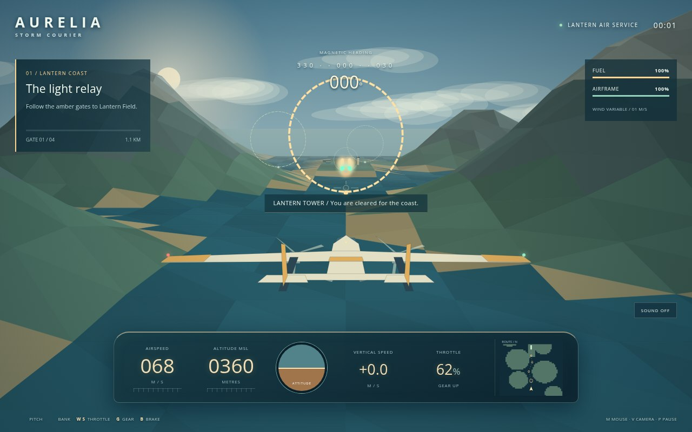

[](https://make.fun/bounty/best-flight-game-20261126-0057?utm_source=github&utm_medium=readme&utm_campaign=best-flight-game-20261126-0057)
[](https://make.fun/bounty/best-flight-game-20261126-0057/leaderboard?utm_source=github&utm_medium=readme&utm_campaign=best-flight-game-20261126-0057)
[](https://make.fun/bounty/best-flight-game-20261126-0057?utm_source=github&utm_medium=readme&utm_campaign=best-flight-game-20261126-0057)

# AURELIA: Storm Courier

An original offline browser flight game about flying a small utility aircraft through the Aurelian archipelago. Manage airspeed and bank, protect fuel and cargo, thread beacon rings, answer rescue calls, and bring every sortie home to a mountain runway.



## Play

```sh
node serve.mjs
```

Open `http://localhost:8080/` in a desktop browser. The flight deck offers three sorties: Lantern Run threads two navigation gates, Whitewing Relay adds a storm rescue, and Nightglass Approach starts on a dusk landing. Keep an eye on fuel, cargo integrity, hull, radar altitude, and landing sink rate; score reflects gates, rescue, cargo, fuel, and landing quality.

Controls: `1`-`3` choose a sortie, `Enter` launches or resumes, `W`/`S` adjust throttle, arrow keys or `A`/`D` bank, `Up`/`Down` pitch, `Q`/`E` rudder, `F` toggles flaps, `Space` pauses, `R` restarts, `M` mutes audio, and `Escape` returns to the flight deck. Hold and drag on the canvas to bank and pitch. For a safe runway 36 touchdown, line up northbound, lower flaps, level the wings, target 65-110 knots, and reduce sink below 750 feet per minute.

## Flying the courier

- **Lantern Run:** cross both amber gate planes inside their circular apertures, then return the medicine to Aster Ridge. A closer, level crossing earns more points; simply flying near a gate earns none.
- **Whitewing Relay:** fly the storm route, descend to the flare at 804 feet, and hold within 190 metres for 1.2 continuous seconds with wings level and airspeed below 160 knots. The deployment bar resets when the pass becomes unstable. Counter the crosswind on the return approach.
- **Nightglass Approach:** start on a dusk final with flaps deployed. Use the runway lights, lateral alignment needle, attitude gauge, radar altitude and approach checklist to land softly.

Banking increases load and stall speed. Stalls, prolonged steep banks, excessive airspeed and deploying flaps above 130 knots damage the hull and cargo; hull damage reduces available power. Fuel consumption increases with power and load. An empty tank stops the engine and forces a descending glide, while wind noise continues. A safe early diversion saves the aircraft but leaves the mission unfinished. Completed sorties reward landing quality, fuel reserve and cargo condition; the best completed score is saved locally when browser storage is available.

The original AR-7 courier has animated flaps, fixed landing gear, running lights and illuminated cockpit instruments. Terrain, buildings, sea, weather and sky are drawn procedurally. Twin engine harmonics, filtered wind, navigation tones, rescue and landing cues, crash sound and warning tones are synthesized locally with Web Audio. Audio starts with a launch gesture and can be muted; losing focus pauses flight.

## Check

Install the small local development tools with `npm ci`, then run `npm run verify` for flight-model and browser controls, `npm run capture` for four genuine frozen browser captures, and `npm run verify:build` to compare two clean output runs and validate the official dossier. To build by hand, use `MAKEFUN_OUTPUT_DIR=out npm run build`.

The hand-in entrypoint uses only Node's standard library and the unchanged official `vendor/makefun-game.ts`. Node 22.18+ with TypeScript stripping can run `MAKEFUN_OUTPUT_DIR=out node main.ts` directly. The npm build command uses `tsx` because some Alpine Node packages omit TypeScript support. Browser checks and capture use the system Chromium at `/usr/bin/chromium`; set `CHROMIUM_PATH` to another installation if needed.

Capture views are `?shot=coast`, `?shot=storm`, `?shot=beacon`, and `?shot=landing`. They freeze the regular renderer at reproducible flight states. Press Enter to begin the selected sortie normally. Captures are unedited 1280×720 browser JPEGs; the capture tool also repeats each view and compares its bytes. Live flight uses a smaller terrain canvas under an independent, full-resolution instrument canvas; frozen views render both at full resolution.

Verification flies all three sorties from their real starting positions using only flight controls, then checks missed gates, continuous rescue deployment, fuel exhaustion, damage, flap stress, stalls, terrain impacts, hard landings and safe diversions. Chromium checks menu selection, keyboard and pointer flight, throttle, flaps, pause, retry and mute while rejecting external requests and runtime errors. The build check compares every output byte across two fresh runs, matches both dossiers to the unchanged official helper and resolves every page and module reference inside `game/`.

## Competition

[Make the best flight game](https://make.fun/bounty/best-flight-game-20261126-0057)

The chase view keeps the aircraft, terrain, target, altitude, airspeed, and heading visible together. Objectives use real positions and altitude; progress is earned by flying gates, stabilizing over the rescue flare, and meeting runway touchdown limits. Fuel and cargo condition affect the final score. The flight model, mission director, world scene, aircraft mesh, HUD, input, and audio each have their own source module.

The browser game ships as static files, has no runtime dependencies, and makes no network requests. The development browser tools are not part of `game/` or the hand-in output.
